

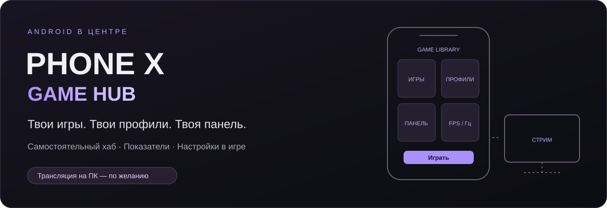

# Phone X Game Hub

**Игровой хаб для Android. Свои профили, панель в игре и показатели экрана.**

[Скачать APK 1.17.6](https://github.com/UnholyHyde/XPhone/releases/download/v1.17.6/XPhone-Android-1.17.6.apk) · [Windows 1.4.2](https://github.com/UnholyHyde/XPhone/releases/download/v1.17.6/XPhone-Setup-1.4.2-x64.exe) · [Telegram](https://t.me/FCKNHYDE) · [Обратная связь](https://github.com/UnholyHyde/XPhone/issues) · [Поддержать разработчика](https://donatepay.ru/don/unholyhyde)

Android — основное приложение · Windows — по желанию · USB / Wi-Fi / локальная сеть

## Содержание

1. [Что представляет собой проект](#about)
2. [Кому пригодится](#audience)
3. [Возможности хаба](#features)
4. [Установка на телефон](#install)
5. [Обучение: библиотека и профиль игры](#library)
6. [Обучение: панель и плавающие окна](#overlay)
7. [Full Focus и режимы питания](#focus)
8. [Сколько ресурсов требуется](#resources)
9. [Дополнение: трансляция на компьютер](#stream)
10. [XPhone, DouWan и карта захвата](#comparison)
11. [Совместимость и ограничения](#limits)
12. [Планы: режим для слабых телефонов](#roadmap)
13. [Помощь, обратная связь и поддержка](#feedback)
14. [На чём построен проект](#credits)

## Что представляет собой проект

**Phone X Game Hub** — самостоятельное приложение для тех, кто играет на Android и хочет собрать игры, настройки и быстрые действия в одном месте. В интерфейсе и названиях файлов используется короткое имя **XPhone**.

Добавьте игры в библиотеку, настройте для них профили и вызывайте игровую панель двойным нажатием на язычок. Можно оставить только нужные кнопки, вывести FPS/Гц отдельным окошком или пользоваться хабом без компьютера и трансляций.

**Передача экрана на ПК — дополнительная возможность.** Если нужен стрим или OBS, Windows-приложение поможет подключить телефон и открыть его экран со звуком. Если стрим не нужен, ПК-часть устанавливать не требуется.

> **Статус: тестовая разработка.** Актуальный [релиз](https://github.com/UnholyHyde/XPhone/releases/tag/v1.17.6): Android **1.17.6** и Windows **1.4.2**. APK, установщик EXE, контрольные суммы SHA-256 и соответствующие исходники опубликованы вместе. Архивы `Source code` предназначены для разработчиков и не являются установщиками. Совместимость с другими моделями ещё требует обратной связи тестеров.

## Кому пригодится

| Сценарий | Как пользоваться |
|---|---|
| Играю только на телефоне | Библиотека, профили, быстрые действия и показатели. Компьютер не нужен. |
| Хочу меньше кнопок на экране | Выберите свой набор плиток, закройте большую панель, оставьте нужные мини-окна. |
| Играю в несколько игр с разными настройками | Создайте личный профиль для каждой игры. |
| Хочу видеть состояние телефона | Заряд, температура батареи, RAM, сеть, трафик и доступные CPU/GPU; отдельно FPS и Гц. |
| Стримлю мобильные игры | Добавьте Windows-приложение и захватите окно телефона в OBS. |
| Нужен только вывод экрана | ПК-приложение умеет обычное зеркалирование; игровой хаб и Shizuku для него не обязательны. |

Это сценарии использования, а не статистика аудитории. Сравнительные испытания на слабых телефонах ещё впереди.

## Возможности хаба

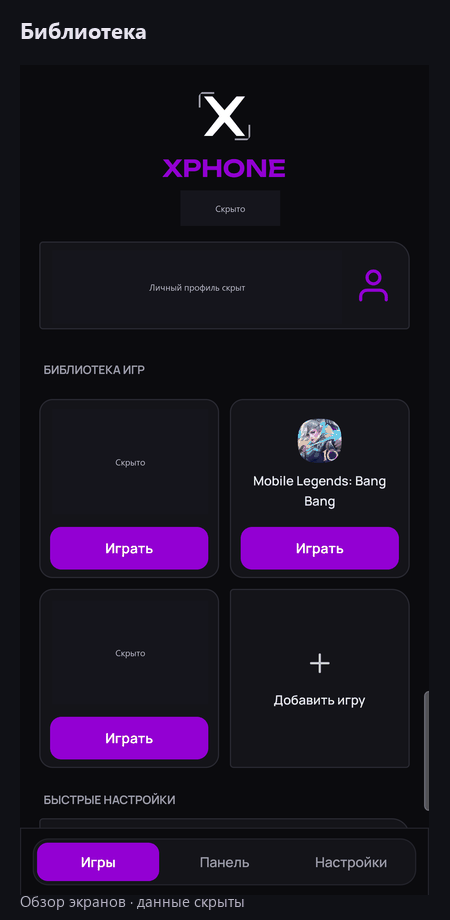

*Короткий GIF-обзор экранов, без курсора и личных данных.*

### Игры и личные настройки

- Библиотека с иконками, названиями и отдельной кнопкой **«Играть»**.
- **Профиль каждой игры**: доступные автодействия, режим питания, яркость, набор кнопок и дополнительные окна.
- **Игровое время**: доступная история Android, новые сохранённые данные и график последних семи дней.
- Локальный профиль игрока: ник, аватар и отображаемое имя устройства. Регистрация аккаунта XPhone не требуется.

### Игровая панель

- Темы **«Графит»** и **«Стекло»**, собственный цвет через HEX/RGB, настраиваемый состав кнопок.
- Язычок с **двойным нажатием**, переносом удержанием к любой стороне и сохранением положения.
- Системное отключение микрофона, «Не беспокоить» с таймером, яркость, очистка обычного фона, доступные режимы питания.
- Светящиеся точки касаний без линий и координат; отдельно — поддерживаемая телефоном чувствительность.
- Приложения в системных плавающих окнах и исключения из очистки, если прошивка поддерживает этот режим.
- Системная запись экрана при доступной интеграции; быстрая запись через Shizuku **без звука**.
- Выбор разрешения отрисовки и питание от USB по порогу заряда — только при поддержке устройством и правами.

Кнопки, для которых нет поддержки или разрешений, скрываются. Список на двух разных телефонах может отличаться.

### Показатели и мини-окна

| Показатель | Что он означает |
|---|---|
| FPS | Фактическая частота композиции экрана по счётчику SurfaceFlinger. Это не выбранный лимит FPS и не независимый счётчик уникальных кадров игры: оверлеи тоже могут создавать кадры. |
| Гц | Текущая частота режима дисплея. Она может быть выше FPS. |
| RAM | Процент занятой оперативной памяти; в подробностях — объёмы. |
| Температура | Температура **батареи**, а не CPU. Цветовая шкала — ориентиры XPhone, не пределы производителя. |
| CPU / GPU | Доступная загрузка устройства; показатели скрыты, если нет поддерживаемого источника. |
| Задержка | Ответ домашнего роутера, **не пинг игрового сервера**. |
| Входящий / исходящий трафик | Текущая передача данных телефона, **не предельная скорость интернета**. |
| Сеть и VPN | Отдельные значки подключения и состояния VPN. VPN может использоваться не всеми приложениями. |

Нажмите показатель в шапке, чтобы открыть его текущие данные. Обучающие пояснения можно отключить, сами значения останутся доступны.

## Установка на телефон

1. Откройте [Releases](https://github.com/UnholyHyde/XPhone/releases), скачайте **APK** и установите его на Android.
2. Откройте XPhone. Для панели выдайте **«Поверх других приложений»**, а для распознавания игр и статистики — **доступ к истории использования**. На новых Android может потребоваться разрешение уведомлений для игровой службы.
3. Добавьте игру в библиотеку, если она не определилась автоматически.
4. При необходимости установите **Shizuku** для расширенных функций.
5. Оставьте игровую службу включённой, запустите игру и дважды нажмите язычок.

### Зачем нужен Shizuku

[Shizuku](https://shizuku.rikka.app/) — отдельное приложение, которое позволяет XPhone выполнять разрешённые вами системные команды с возможностями Android shell, без root. Это не часть APK XPhone и не автоматическая выдача всех разрешений.

Установите Shizuku с [официальной страницы](https://shizuku.rikka.app/download/), запустите по его [инструкции](https://shizuku.rikka.app/guide/setup/) и разрешите доступ XPhone. Доступность способа запуска зависит от Android: в частности, беспроводной запуск используется на Android 11+. После перезагрузки Shizuku обычно нужно запустить заново.

Без Shizuku остаются библиотека, доступная системная статистика и базовый интерфейс. Расширенные действия, зависящие от него, не становятся рабочими от одного наличия их названия в инструкции. Для обычного вывода экрана через ПК Shizuku не обязателен.

## Обучение: библиотека и профиль игры

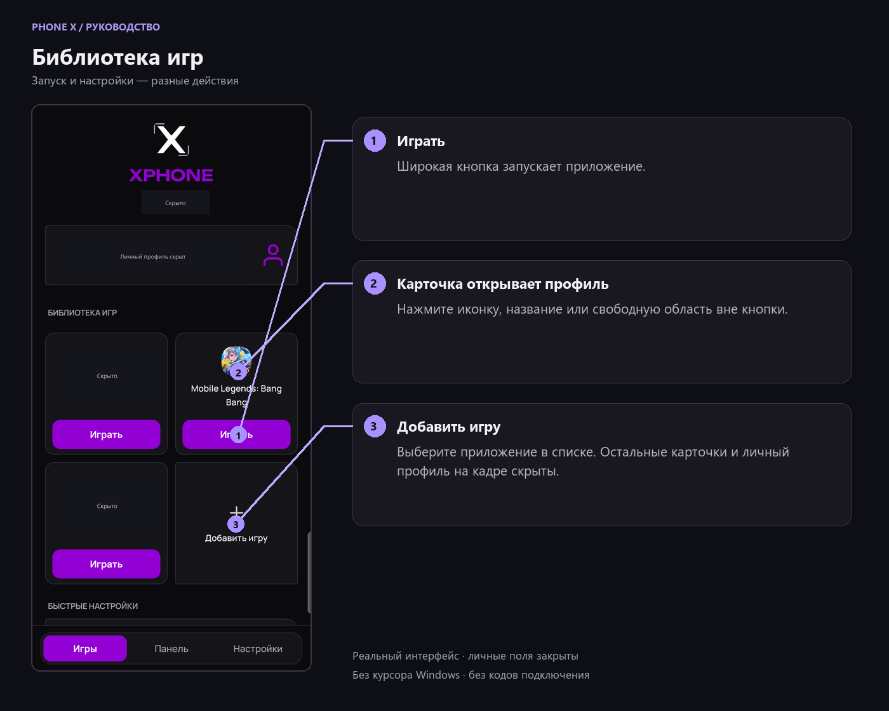

### Добавить и запустить игру

1. Откройте вкладку **«Игры»**.
2. Нажмите **«Добавить игру»** и выберите приложение в списке с поиском.
3. Нажмите широкую кнопку **«Играть»** в карточке для запуска.
4. Нажатие на любую другую область карточки открывает **профиль этой игры**, а не запускает её.

### Настроить профиль

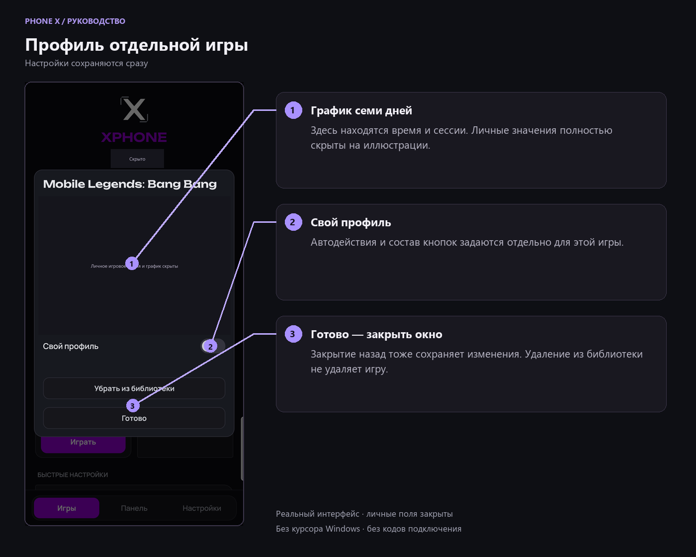

Включите **«Свой профиль»** и выберите нужные автодействия. Выключение профиля отключает его автодействия, но не удаляет сохранённые настройки. Глобальные настройки служат шаблоном новых профилей, а уже созданные имеют собственные значения.

**Все изменения сохраняются сразу.** «Готово» закрывает окно; закрытие назад или вне окна также не отменяет настройки. **«Убрать из библиотеки»** убирает карточку, а не удаляет приложение с телефона и не стирает сохранённую историю.

### Посмотреть игровое время

В окне игры есть семидневный график. Последний столбец — сегодня. Нажмите столбец для времени и числа начатых сессий. Даты определяются **системным временем и часовым поясом телефона**, без привязки к Москве.

XPhone импортирует доступные итоги Android и сохраняет последующие данные локально. Повторное открытие не должно прибавлять те же часы заново. Текущий незавершённый интервал также учитывается; открытый профиль обновляется примерно каждые пять секунд, пока Android предоставляет события.

Android хранит подробную историю ограниченное время. Если старые часы или события сессий уже удалены, XPhone не может восстановить их из ничего. Поэтому **«Учтено» не означает гарантированное время за всю жизнь игры**, а «нет данных» не означает ноль. Возврат в игру менее чем через 30 секунд объединяется в одну сессию; через 30 секунд и больше — новая. Переход через полночь не создаёт новую сессию сам по себе.

## Обучение: панель и плавающие окна

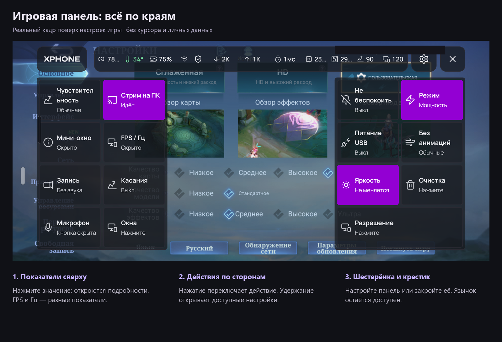

### Открыть, закрыть и переместить

- **Открыть:** дважды нажмите язычок. Одиночное нажатие и свайп панель не открывают.
- **Закрыть:** нажмите крестик. Язычок и включённые мини-окна остаются доступны.
- **Переместить:** удерживайте язычок, перетащите к нужной стороне и отпустите. Он может быть слева, справа, сверху или снизу.
- **Выбрать сторону из меню:** «Панель → Язычок панели» в хабе или «Шестерёнка → Расположение язычка» в игре.
- **Скрыть до возвращения:** соответствующее действие в шестерёнке временно убирает оверлей. Возвращение через хаб/главный экран учитывается отдельно.

В самом хабе игровые окна скрываются. Это не выключение службы: при возвращении в игру они восстанавливаются.

### Оставить только нужные кнопки

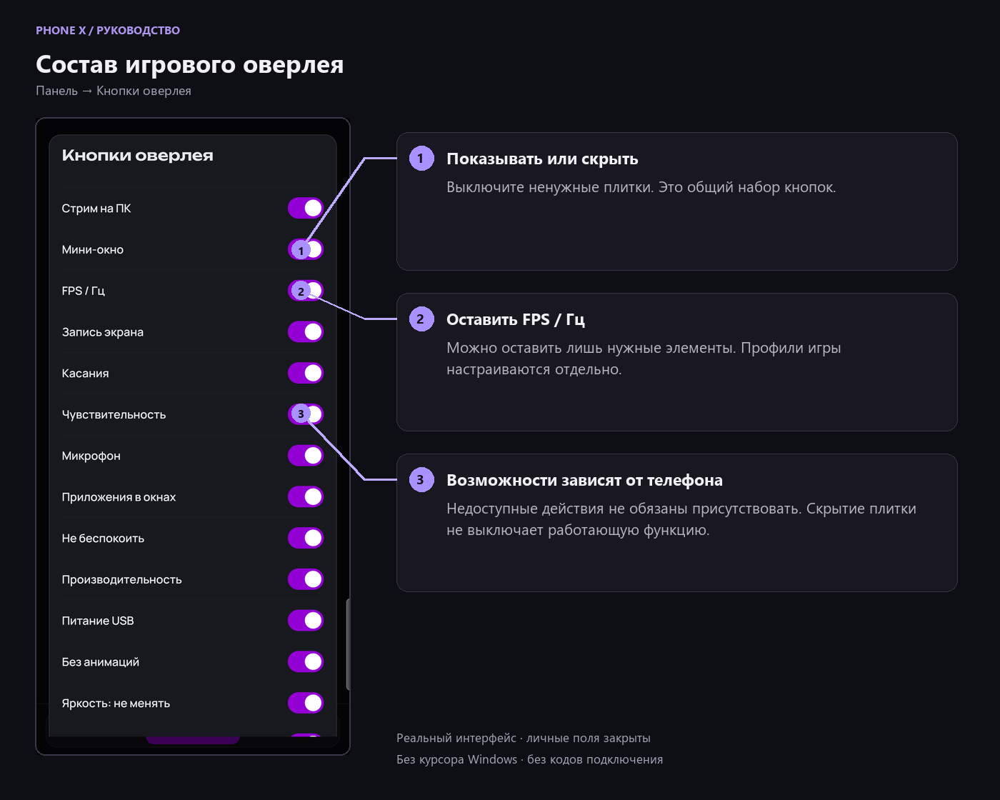

Откройте **«Панель → Кнопки оверлея»** или одноимённый пункт настроек. Для игры со включённым собственным профилем задавайте набор **внутри её профиля**.

Можно скрыть хоть все плитки: включённые автодействия профиля продолжат работать. Но **скрытие кнопки не выключает функцию**, её автозапуск или уже показанное окно. Запись и очистка не запускаются автоматически просто потому, что их кнопки скрыты.

Для сценария «только стрим» оставьте, например, «Стрим на ПК» и «FPS / Гц», а остальные окна и автодействия выключите отдельно.

> Главный тумблер **«Игровая панель включена»** управляет всей игровой службой. Его выключение останавливает распознавание игр, автоприменение профилей и плавающие игровые окна. Он не равнозначен скрытию лишних кнопок.

### Нажатие и удержание

| Элемент | Нажатие | Удержание |
|---|---|---|
| Мини-окно | Показать/скрыть строку показателей | Состав, прозрачность, подложка и закрепление |
| FPS / Гц | Показать/скрыть отдельное окно | Подложка, прозрачность и закрепление |
| Микрофон | Показать/скрыть плавающую кнопку | Её прозрачность |
| Плавающий микрофон | Выключить/включить микрофон телефона | Прозрачность кнопки |
| Не беспокоить | Включить/выключить без таймера | Выбрать длительность |
| Режим | Следующий доступный вариант | Прямой выбор режима |
| Яркость | Включить/выключить фиксацию | Ползунок с изменением яркости |
| Питание USB | Переключить поддерживаемый режим | Порог заряда |
| Запись | Старт/остановка выбранного способа | Способ записи и битрейт быстрой записи |
| Окна | Последнее выбранное приложение | Выбор приложений |

Незакреплённые мини-окна можно перетаскивать. Закреплённые пропускают нажатия в игру; снять закрепление можно через настройки окна. Для совместимости с касаниями Android ограничивает доступную непрозрачность закреплённых окон. Плавающий микрофон скрывается на время раскрытия большой панели.

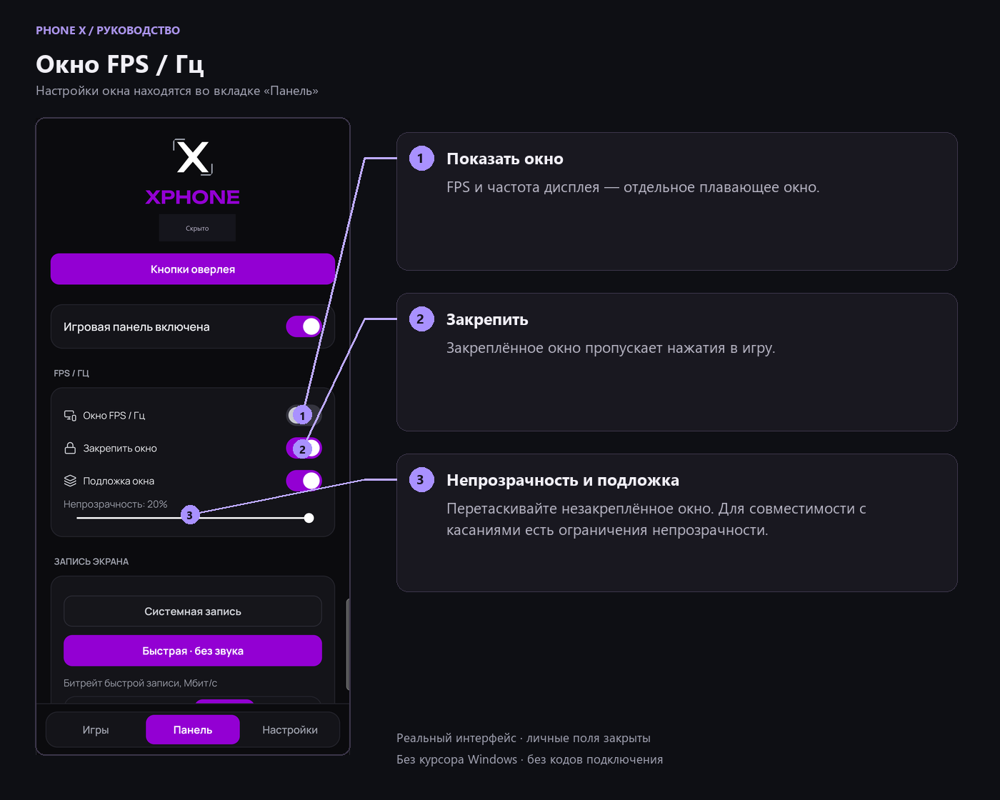

### Запись экрана

**«Системная запись»** открывает поддерживаемый рекордер телефона и его окно выбора звука. Нейтральное название не означает универсальной интеграции: сейчас системный адаптер реализован для Samsung.

**«Быстрая · без звука»** использует доступный screenrecord через Shizuku. Сохраняет видео в `Movies/XPhone`, запускается без системного окна, но **не записывает звук**. Значения 4 / 8 / 12 / 20 — **Мбит/с**, не мегабайты; выбранный битрейт применяется к следующему запуску. Способы показываются по доступности.

## Full Focus и режимы питания

**Эконом / Баланс / Производительность** используют доступные системные режимы. Это не разгон и не снятие защиты нагрева. На Samsung смена режима уже работающей игры ограничена: XPhone не должен провоцировать её принудительное закрытие.

**Full Focus** — дополнительный тестовый режим для игры с Shizuku на Android 15+. Он создаёт собственное строгое правило уведомлений, разрешает медиа для звука игры, выбирает доступную производительность/баланс и один раз очищает обычный фон. При завершении удаляет своё правило и возвращает сохранённые настройки.

**Что важно понимать:**

- Обычные звонки и уведомления должны подавляться правилом, но перед использованием в турнире это нужно проверить на своей прошивке.
- Входящий вызов не блокируется у оператора. Экстренные системные оповещения и нестандартные окна прошивки не покрыты обещанием полного подавления.
- Звук игры сохраняется по политике медиа, но его и голосовой чат также проверьте на устройстве.
- **Весь CPU/GPU и весь интернет только игре режим не выделяет.** Остальные приложения не получают постоянный сетевой запрет и могут возобновить фоновую работу.
- VPN, системные компоненты и защищённые приложения не должны закрываться очисткой.

**Автоматическое отключение штатного Game Booster сейчас недоступно.** На проверенной Samsung-прошивке отключение Game Tools вызывало принудительное завершение игр службой GOS; этот механизм удалён. Системная и тепловая защита не отключается.

## Сколько ресурсов требуется

**Новый прогон XPhone 1.17.6 от 6 ноября 2026:** девять серий, 54 интервала, суммарно около десяти минут измерений. Старые показатели 1.15.0 заменены этим набором. Проверены хаб, язычок, большая панель, два мини-окна, выключенная служба и USB-трансляция.

Тест выполнен на одном устройстве Samsung, Android 17; Windows-клиент **1.4.1**. В игре открыта одна и та же страница настроек с анимированным предпросмотром, **не матч**. Поток по USB: ограничение 60 FPS, до 30 Мбит/с, max-size 2336. Это заданные пределы, не измеренные параметры доставки.

### Сам XPhone на телефоне

| Сценарий с включённой трансляцией | Средняя RAM XPhone | CPU XPhone, включая команды |
|---|---:|---:|
| Открытый хаб | 128,5 МиБ | 0,37% одного ядра |
| Игра, только язычок — первая серия | 109,3 МиБ | 6,27% одного ядра |
| Игра, открытая большая панель | 186,9 МиБ | 6,77% одного ядра |
| Игра, два мини-окна | 107,4 МиБ | 7,06% одного ядра |
| Игра, два мини-окна — повтор | 113,7 МиБ | 7,29% одного ядра |
| Игра, язычок после восстановления службы | 94,1 МиБ | 6,03% одного ядра |

Здесь только процессы XPhone со службой: **PSS с уже включёнными графическими буферами**. Игра, Shizuku, сервер трансляции и общие службы не включены. **100% CPU процесса = одно занятое логическое ядро, не весь телефон.** Значения в таблице — средние конкретных серий, а не постоянный расход или абсолютный пик.

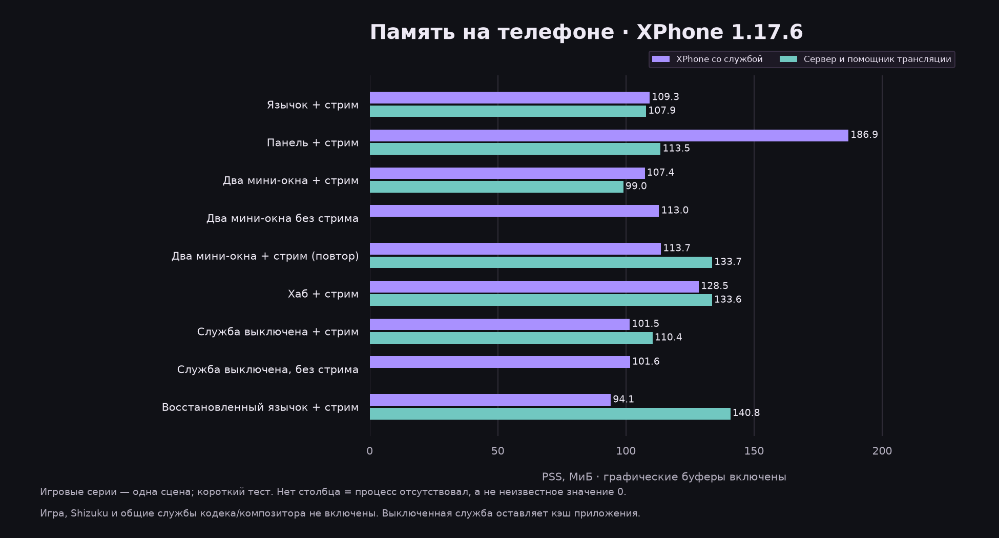

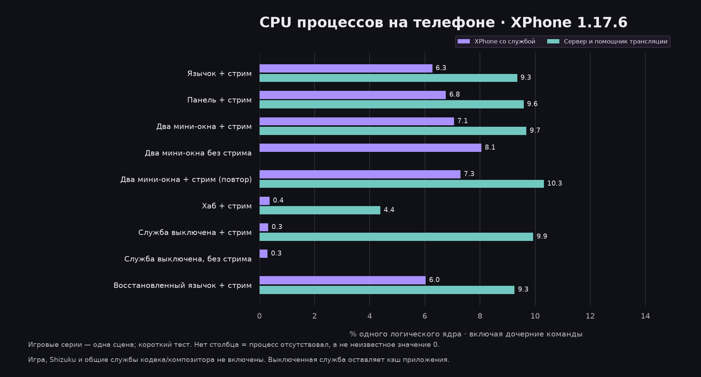

### Что дополнительно требует трансляция

- **На телефоне:** в игровых сериях сервер и помощник scrcpy занимали в среднем **99–141 МиБ PSS** и **9,3–10,3% одного ядра CPU**. Это дополнение к XPhone, а не уже включённая в таблицу память.
- **Общие службы телефона:** аппаратный кодек показывал примерно **19–20% одного ядра** со стримом и около нуля без него. Композитор и GPU также выполняют работу. Эти службы используются системой; целиком приписывать их XPhone нельзя.
- **На ПК:** окно трансляции в игровых сериях занимало **79–89 МиБ Working Set** и примерно **0,8–1,2% общего CPU** тестового ПК с 12 логическими процессорами. Оболочка Windows занимает память отдельно.
- **GPU ПК:** шесть дополнительных срезов дали **7–10% VideoDecode**. Это загрузка отдельного аппаратного декодера, не всего GPU.

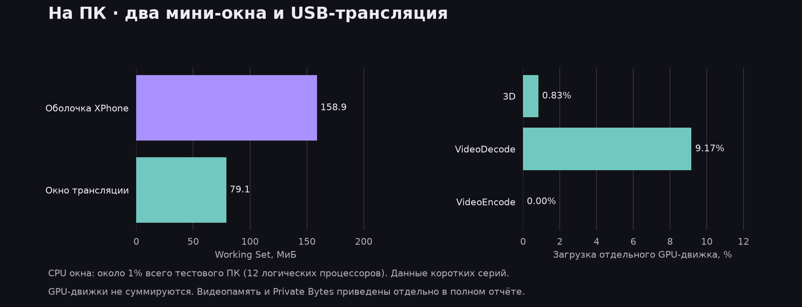

### Выводы и границы теста

Хаб на статичном экране требует мало CPU. В игре опрос характеристик продолжается даже при одном язычке: это подтверждённая точка оптимизации для облегчённого режима. **Скрытие кнопок не останавливает телеметрию.** При выключенной игровой службе CPU XPhone снижался примерно до **0,3% одного ядра**, но около **102 МиБ** оставалось в кэшированных процессах.

Батарея была **35,9–36,7 °C**, тепловой статус Android оставался 0. Телефон питался по USB: автономность, расход батареи в час и нагрев именно от XPhone этим прогоном не определены. Переподключение изменило размер окна ПК; системный фон и восстановление профильных настроек также мешают точному причинному вычитанию двух строк.

Глобальный счётчик композиции показывал около **90 кадров/с**, в одной контрольной серии — около **119**. Это **не FPS уникальных кадров игры** и не доставленные FPS потока. Разница требует отдельного исследования и не доказывает потерю 30 FPS от оверлея.

Реальный матч, запись одновременно со стримом, Wi-Fi/LAN, сквозная задержка, длительный тест утечек и слабые устройства в этот прогон не включены. Неизмеренное не заменено нулями; ускорение игры и превосходство над конкурентами не заявляются.

[Полный отчёт: условия, все девять серий, RAM/CPU/GPU, кадры и температура](docs/measurements/1.17.6/REPORT.md) · [CSV](docs/measurements/1.17.6/summary.csv) · [Подробная сводка JSON](docs/measurements/1.17.6/summary.json) · [Обезличенные интервалы](docs/measurements/1.17.6/series/) · [Скрипт диаграмм](docs/tools/plot_benchmark.py).

## Дополнение: трансляция на компьютер

Windows-часть выводит экран и звук Android в отдельное окно для OBS, записи или большого монитора. **Карта захвата для такого программного способа не нужна.**

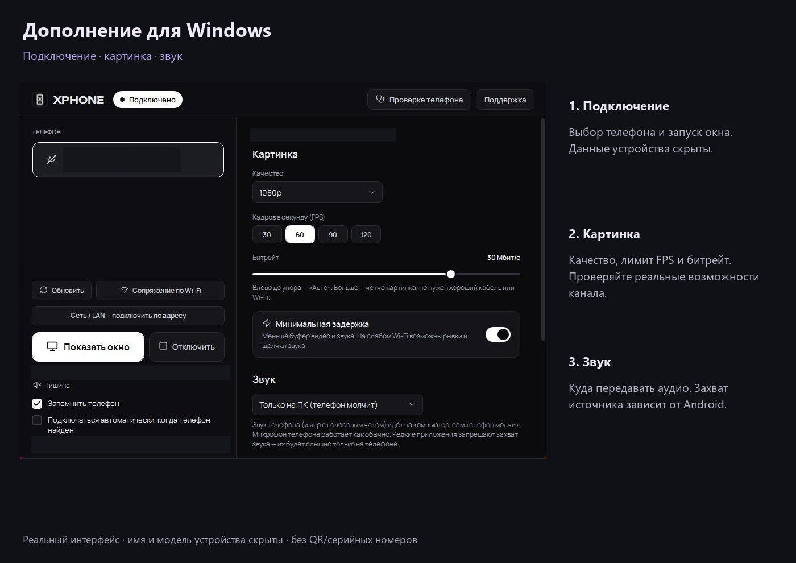

### По USB

1. Установите Windows-приложение из [Releases](https://github.com/UnholyHyde/XPhone/releases). Выбирайте EXE-установщик, не исходный код.
2. На телефоне включите параметры разработчика и отладку USB.
3. Подключите кабель **с передачей данных**, разблокируйте телефон и подтвердите доверие этому компьютеру.
4. Откройте XPhone на ПК, выберите телефон и нажмите **«Подключить»**.
5. Дождитесь отдельного окна экрана. Для управления можно нажимать мышью; игра при этом остаётся приложением телефона.

Готовый установщик включает служебные компоненты; отдельно ставить Node.js, Java, Gradle, ADB или scrcpy пользователю не требуется. ПК-версия и игровой профиль телефона — разные настройки.

### По Wi-Fi

В главном окне ПК откройте **«Сопряжение по Wi-Fi»**. На Android 11+ включите беспроводную отладку и выберите QR-сопряжение либо ввод кода. Телефон и ПК должны быть доступны друг другу в локальной сети.

Порт **сопряжения** и порт обычного **подключения** — разные вещи. Код/QR могут меняться; используйте текущие значения. Не публикуйте их в скриншотах и Issues. При проблемах с обнаружением проверьте VPN и изоляцию устройств в роутере. USB-подключение не требует выключать VPN само по себе.

### По локальной сети и Ethernet

Раздел **«Сеть / LAN»** подключает по адресу и порту. Ethernet-переходник телефона может использовать ту же локальную сеть, но **реальная работа с переходником ещё не проверена**. Возможность подготовки классического ADB-порта зависит от прошивки; она не заменяет первичное доверие/сопряжение.

Классический ADB TCP-порт5555 не использует TLS — включайте такой режим только в доверенной сети. Сам факт кабельного интернета не гарантирует меньший пинг игрового сервера.

### Картинка, звук и OBS

- Настройте качество, ограничение FPS и битрейт на ПК. Запрошенные1080p/120 FPS не гарантируют такие реальные параметры у каждой игры.
- **Проверка сети** помогает оценить канал до телефона, выбрать битрейт и режим минимальной задержки. Это не тест скорости до игрового сервера.
- **«Только на ПК»** отправляет звук в вывод Windows; **«И на ПК, и на телефоне»** дублирует его при поддержке Android; **«Без звука»** отключает аудиопоток трансляции. Захват может запрещаться источником.
- В OBS добавьте **«Захват окна»** и выберите окно экрана XPhone. Для звука выберите захват звука приложения `xphone-screen.exe` либо уже настроенный рабочий стол, не два одинаковых источника одновременно.
- Перед эфиром отдельно проверьте звук игры, микрофон, голосовой чат и уведомления.

В Android-панели «Стрим на ПК» управляет уже подготовленным соединением. Одного добавления игры в библиотеку недостаточно для первого сопряжения с компьютером.

Экспериментальная защита системных уведомлений при стриме скрывает баннеры и ограничивает шторку **также на телефоне**. Она не является универсальным блюром только картинки ПК. Для обмена подтверждением защиты до запуска захвата нужны совместимые новые версии обеих частей; на старой ПК-версии такой гарантии нет. Внутриигровой чат и нестандартные окна приложений автоматически не скрываются.

## XPhone, DouWan и карта захвата

Это сравнение подходов, **не сравнительный тест задержки или FPS**. Для XPhone преимущество — сочетание самостоятельного Android-хаба и необязательной трансляции в одном проекте.

| Что нужно | XPhone | DouWan | Карта захвата |
|---|---|---|---|
| Игровой хаб без компьютера | Собственная Android-библиотека, профили и оверлей | Основной заявленный сценарий — зеркалирование; полный аналог хаба здесь не проверялся | Сама карта такой интерфейс не добавляет |
| Вывод телефона на ПК | Программно, через scrcpy/ADB | USB и беспроводное зеркалирование по данным производителя | Аппаратный видеозахват совместимого видеовыхода |
| Покупка устройства захвата | Не нужна для программного вывода | Не нужна для программного вывода | Нужна карта, совместимые кабели/переходники |
| Платформы | Android + Windows; iOS/macOS-версии XPhone нет | Производитель заявляет iOS/Android и Windows/macOS | Зависит от карты, телефона и ПО |
| Настройка Android | Отладка/доверие для ПК; Shizuku отдельно для расширенного хаба | Производитель заявляет Android-подключение без USB debugging | Обычно нужен подходящий видеовыход телефона; условия зависят от тракта |
| Как выбрать | Если нужен настраиваемый хаб и доступ к его исходникам вместе со стримом | Если подходит готовый набор зеркалирования DouWan | Если нужен отдельный аппаратный тракт и телефон его поддерживает |

Сведения о DouWan сверены по [официальному сайту](https://douwan.tv/index_en.html) 6 ноября2026. Поддержка, тарифы и ограничения могут меняться; перед выбором проверьте актуальную страницу. Мы не утверждаем, что у DouWan отсутствуют непроверенные нами функции, что XPhone быстрее него или экономнее карты захвата. Карта также может быть частью большого тракта с дополнительной задержкой и требованиями к телефону — универсального победителя нет.

## Совместимость и ограничения

Проект прежде всего разрабатывался и проверялся на **одной модели Samsung с One UI**. Полноценного прогона на других моделях, слабых телефонах и планшетах пока нет. Проверенный запуск одной игры не означает подтверждённую совместимость всех функций.

| Область | Текущий статус |
|---|---|
| Базовое Android-приложение | Android 8.0+, отдельные функции требуют более новой версии |
| Компьютер | Windows 10/11 x64; отдельного клиента XPhone для Linux/macOS нет |
| Ширина панели | Подстраивается под экран; отдельная доводка вертикального игрового режима и планшетов ещё впереди |
| FPS | Нужен доступный системный источник; счётчик композиции может учитывать оверлеи |
| Питание USB | Только поддерживаемые устройства/зарядки; это не универсальное отключение электричества в USB |
| Чувствительность | Реальная поддерживаемая настройка сенсора, не разгон частоты опроса; текущая интеграция ограничена Samsung |
| Системная запись | Адаптер зависит от прошивки; текущая интеграция Samsung не делает её универсальной |
| Быстрая запись Shizuku | При поддержке screenrecord; без звука |
| Full Focus | Тестовый, Android 15+ и Shizuku; не обещает исключительное выделение ресурсов |
| Game Booster производителя | Автоотключение удалено из-за закрытия игр на Samsung |
| LAN-переходник | Есть реализация, аппаратный прогон ещё не выполнен |
| Языки | Сейчас русский; другие переводы отложены |

Galaxy Watch или другие системные службы могут менять «Не беспокоить». Если режим сам отключается, проверьте настройки синхронизации часов. Экранная запись и зеркалирование также зависят от ограничений Android и приложения-источника.

## Планы: режим для слабых телефонов

**Отдельный облегчённый режим — направление разработки, а не уже готовое обещание «игры без лагов».**

Планируем:

- останавливать ненужные измерения, когда соответствующие показатели не отображаются;
- уменьшать стоимость команд телеметрии и подбирать частоту обновления под сценарий;
- сокращать количество и размер графических буферов, где это возможно;
- предусмотреть оформление с меньшим количеством эффектов и минимумом постоянно видимых окон;
- проверять результат на слабых устройствах: одна игра/сцена, одинаковые настройки, сравнение с выключенным XPhone, длительные замеры FPS, памяти и нагрева.

Не обещаем устранить все лаги: на них влияют сама игра, железо, нагрев, свободная память, сеть и прошивка. Доказанный прирост можно будет заявлять только после таких сравнений. Отдельно остаются переводы, доводка планшетов/вертикальной панели и расширение интеграций системной записи.

## Помощь, обратная связь и поддержка

Если что-то не работает, напишите в [GitHub Issues](https://github.com/UnholyHyde/XPhone/issues) или [Telegram](https://t.me/FCKNHYDE).

Для отчёта полезны версии XPhone/Android, шаги, ожидаемый и фактический результат, тип подключения и наличие Shizuku. Модель и оболочку своего устройства можно указать по желанию для проверки совместимости. Перед отправкой кадров уберите ник, аватар, контакты, уведомления, идентификаторы, сетевые адреса, серийный номер, QR и коды сопряжения. Сырые логи сначала проверьте на личные данные.

**Поддержать разработчика:** [угостить кофе через DonatePay](https://donatepay.ru/don/unholyhyde). Поддержка добровольная и не открывает скрытые функции.

## На чём построен проект

- Собственный Android-хаб: Java, игровые профили, библиотека и оверлей.
- Windows-оболочка: C# / WPF.
- Передача экрана и звука — **[scrcpy](https://github.com/Genymobile/scrcpy)**, в текущей поставке5.0.1, вместе с ADB. Проект не выдаёт этот движок за написанный с нуля.
- Расширенные Android-команды — [Shizuku](https://shizuku.rikka.app/) с разрешением пользователя.
- Иконки [Lucide](https://lucide.dev/), шрифты Manrope и Unbounded, QR через QRCoder.

Спасибо авторам этих проектов. Лицензии и изменения ресурсов движка перечислены в [NOTICE](licenses/NOTICE.txt); они сохраняются в поставке. Сборка и устройство исходников — в [руководстве разработчика](docs/DEVELOPMENT.md).

Иллюстрации интерфейса сняты с работающего приложения. Личные поля закрыты непрозрачными масками; курсор Windows не включён в кадры телефона. Диаграммы ресурсов построены по измеренным данным, а не по скриншотам игрового времени.
