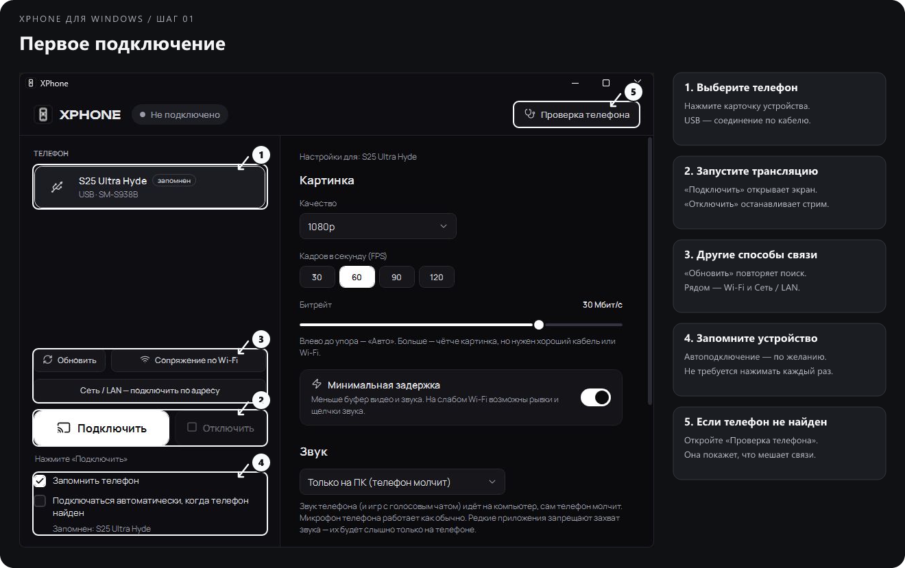
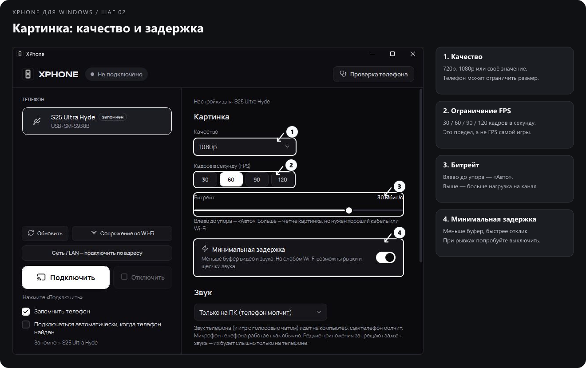
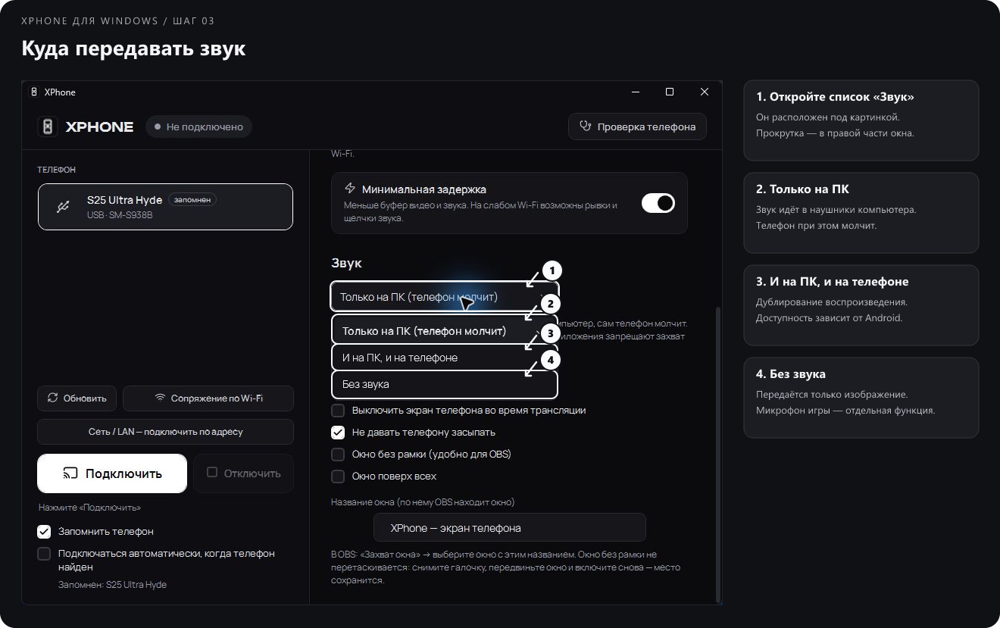
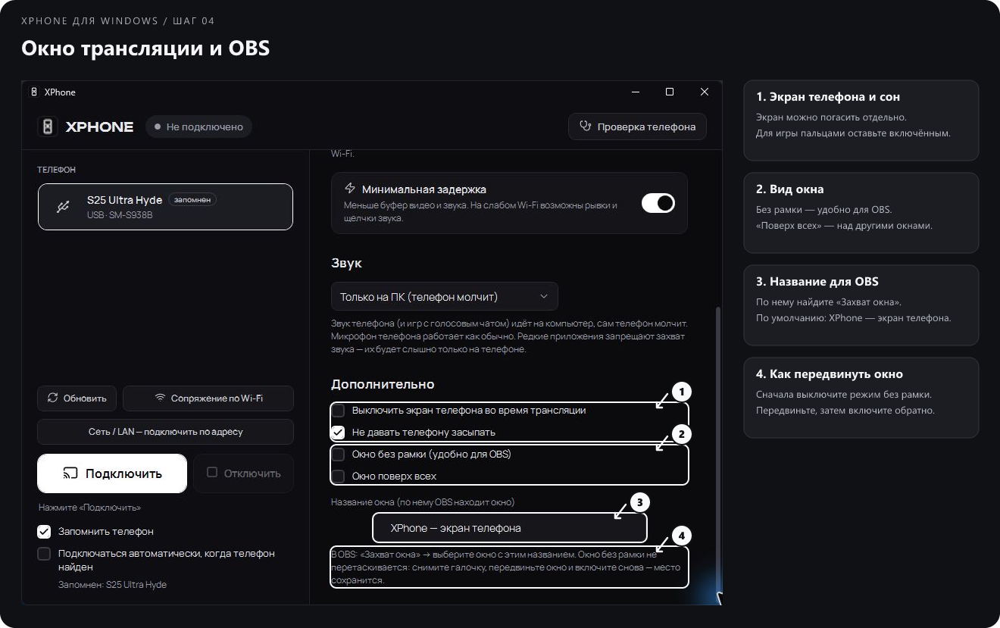
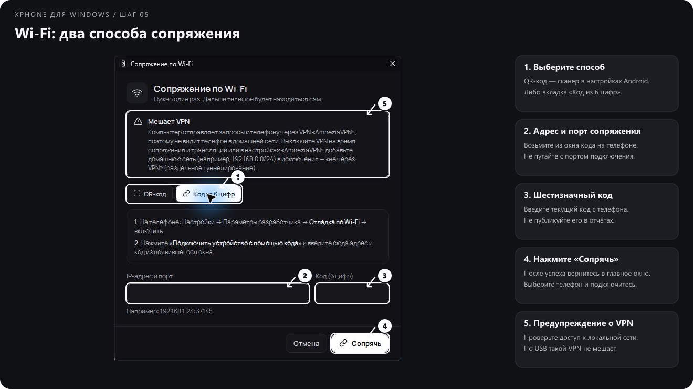
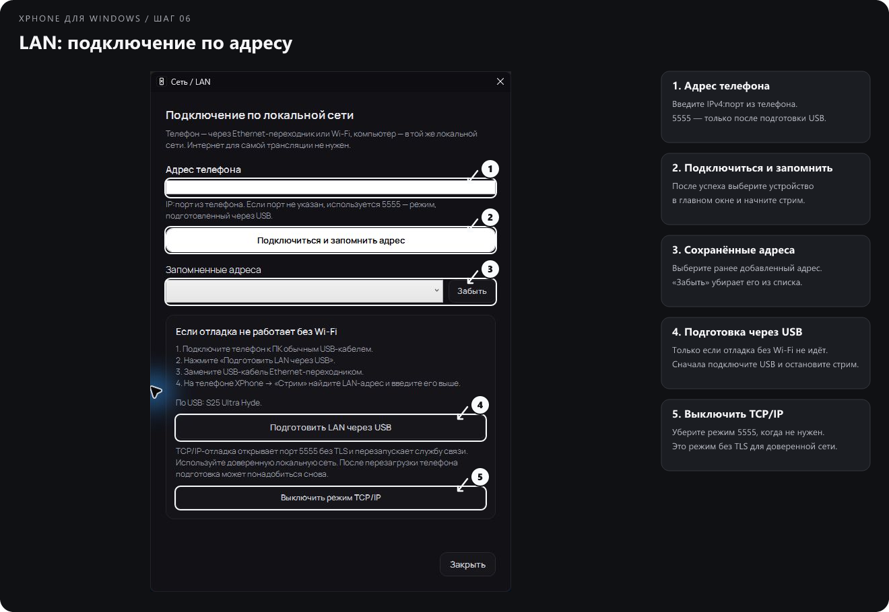
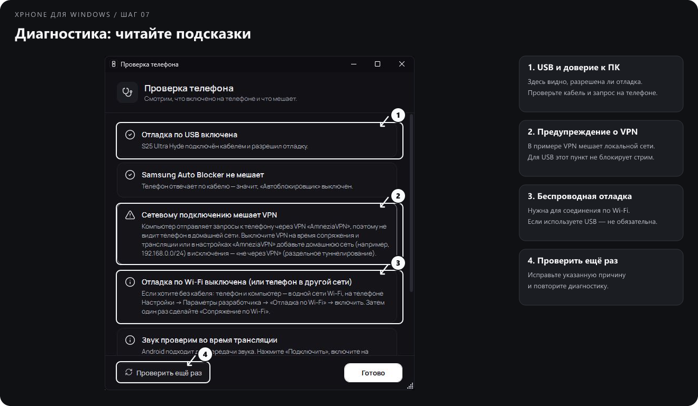
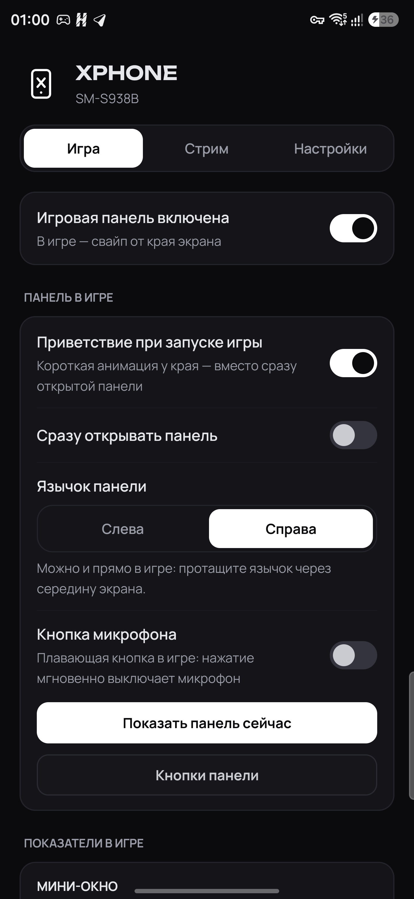
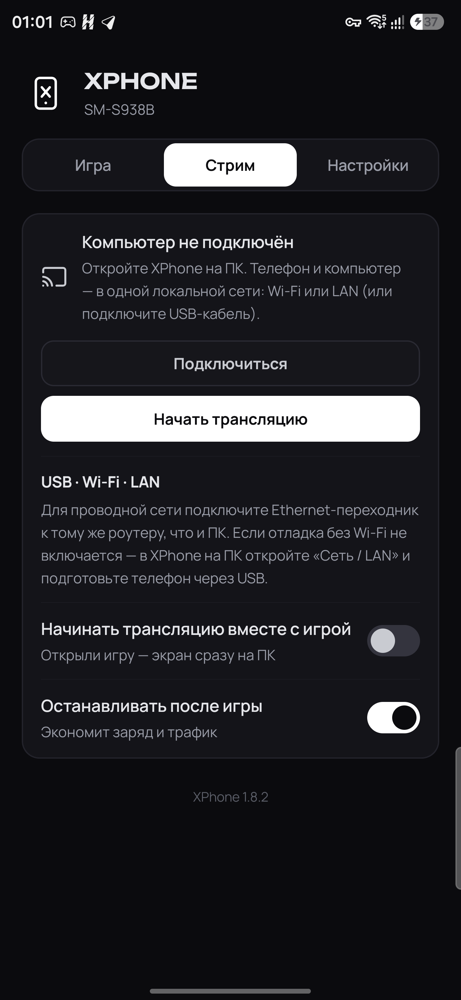

# XPhone

**Экран и звук Android на компьютере. Игровая панель — прямо в игре.**

[Скачать для Windows](https://github.com/UnholyHyde/XPhone/releases/download/v1.8.3/XPhone-Setup-1.4.1-x64.exe) · [Скачать APK](https://github.com/UnholyHyde/XPhone/releases/download/v1.8.3/XPhone-Android-1.8.3.apk) · [Поддержать разработку](https://donatepay.ru/don/unholyhyde) · [Все релизы](https://github.com/UnholyHyde/XPhone/releases) · [Telegram](https://t.me/FCKNHYDE) · [Сообщить о проблеме](https://github.com/UnholyHyde/XPhone/issues)

Windows 10/11 x64 · Android · USB / Wi-Fi / LAN

---

**XPhone — приложение для тех, кто играет на телефоне и хочет вывести изображение и звук на ПК:** для OBS, стримов, записи или большого экрана. Android-приложение добавляет игровую панель с быстрыми действиями и показателями поверх игры. Ею можно пользоваться отдельно, без трансляции на компьютер.

Основа передачи экрана — **[scrcpy](https://github.com/Genymobile/scrcpy)** (Screen Copy), а не отдельный движок, написанный с нуля. XPhone объединяет scrcpy, ADB, интерфейс Windows и собственное Android-приложение в одну связку. В текущей сборке используется scrcpy **5.0.1**. Спасибо авторам scrcpy и Shizuku за основу проекта.

> **Важное о совместимости.** XPhone разрабатывается и проверяется прежде всего на **Samsung Galaxy S25 Ultra**; звук в игре с голосовым чатом проверялся в **Mobile Legends**. На других моделях и планшетах приложение пока не проходило полноценного тестирования. Доступность кнопок зависит от Android, прошивки, аппаратных возможностей и разрешений. Ваши отзывы особенно важны: [GitHub Issues](https://github.com/UnholyHyde/XPhone/issues) или [Telegram-канал](https://t.me/FCKNHYDE).

## Быстрый старт

Впервые открываете ПК-версию? Ниже есть [пошаговое обучение со скриншотами](#обучение-xphone-на-компьютере).

1. **На ПК:** скачайте [XPhone-Setup-1.4.1-x64.exe](https://github.com/UnholyHyde/XPhone/releases/download/v1.8.3/XPhone-Setup-1.4.1-x64.exe), запустите установщик и выберите папку. Можно выбрать другой диск. Ярлык запускает XPhone; удаление доступно через Windows.
2. **На телефоне:** скачайте [XPhone-Android-1.8.3.apk](https://github.com/UnholyHyde/XPhone/releases/download/v1.8.3/XPhone-Android-1.8.3.apk), подтвердите установку APK и откройте приложение. Android-приложение нужно для игровой панели и управления с телефона; простая трансляция через ПК может работать без него.
3. Включите режим разработчика и отладку по USB на телефоне. Подключите **кабель с передачей данных** и подтвердите запрос доверия к компьютеру на экране телефона.
4. Откройте XPhone на ПК, выберите устройство и нажмите **«Подключить»**. Изображение появится в отдельном окне XPhone.
5. Для игровой панели выдайте запрошенные разрешения в Android-приложении, добавьте игру при необходимости и откройте её. Панель вызывается язычком у края экрана.
6. Для расширенных функций установите и запустите Shizuku по инструкции ниже. **Для обычной трансляции Shizuku не обязателен.**

Установщик уже включает среду запуска .NET и служебные компоненты. Пользователю **не нужны отдельные установки Node.js, ADB, scrcpy, Java или Gradle**. Архивы `Source code` на странице релиза — для разработчиков, а не для установки приложения.

## Что входит в XPhone

| Часть | Для чего нужна |
|---|---|
| **XPhone для Windows** | Поиск телефона, подключение, качество изображения, звук, проверка соединения и окно трансляции |
| **XPhone для Android** | Игровая панель, показатели, выбор кнопок, автоматические действия при запуске игры и команды ПК |
| **scrcpy + ADB** | Передача изображения/звука и связь с Android; поставляются внутри ПК-приложения |
| **Shizuku — отдельно, по желанию** | Разрешённые пользователем системные команды для расширенных функций Android-панели |

Трансляция и игровая панель — разные возможности: можно использовать только ПК-версию для экрана либо только Android-приложение как игровую панель. Для запуска трансляции с телефона XPhone на компьютере должен быть открыт, а связь с устройством — настроена.

## Возможности на компьютере

- **Экран Android в отдельном окне XPhone.** Собственное название, режим без рамки, отображение поверх других окон — удобно для захвата в OBS.
- **USB и локальная сеть.** Сопряжение по Wi-Fi через QR-код или код; подключение по IP и порту через «Сеть / LAN».
- **Качество изображения.** Пресеты 720p / 1080p и своё значение, ограничение FPS, автоматический или ручной битрейт, режим минимальной задержки.
- **Звук.** Передача на ПК, дублирование на телефон и ПК либо отключение передачи — с учётом версии Android и ограничений приложения-источника.
- **Настройки для конкретного телефона.** Профиль сохраняется, не нужно каждый раз выбирать всё заново.
- **Диагностика.** «Проверка телефона», понятные сообщения, подробности ошибки и предупреждения о VPN, мешающем домашней сети.
- **Проверка скорости соединения.** Помогает подобрать битрейт и оценить, подходит ли соединение для минимальной задержки. Это оценка текущего канала до телефона, а не гарантия стабильности и не измерение пинга игрового сервера.
- **Управление с Android-панели.** Запуск и остановка трансляции, автоматический запуск вместе с игрой и остановка после выхода.

### О разрешении, FPS и задержке

Выбранные 1080p и 120 FPS — **заданные параметры**, а не обещание, что любая игра выдаст такую картинку. Разрешение ограничено тем, что отдаёт телефон, а частота кадров — игрой, устройством и кодированием. Если телефон работает в более низком разрешении, в статусе может отображаться меньшее значение. Настройка качества трансляции не повышает разрешение самой игры.

Минимальная задержка уменьшает буферы: на стабильном соединении это полезно, на нестабильном может усилить рывки. Высокий битрейт тоже не всегда улучшает результат — проверьте канал и подберите значение по фактической плавности.

## Обучение: XPhone на компьютере

Ниже — настоящие окна **XPhone для Windows 1.4.0** с выделениями, стрелками и номерами. В примере подключён Galaxy S25 Ultra по USB. Имя вашего телефона и предупреждения могут отличаться. **Нажмите на иллюстрацию, чтобы открыть её крупнее.** Числа на снимке соответствуют пояснениям под ним.

[1. Подключить телефон](#1-подключите-телефон-и-откройте-трансляцию) · [2. Картинка](#2-настройте-картинку) · [3. Звук](#3-выберите-куда-передавать-звук) · [4. Окно и OBS](#4-настройте-окно-для-себя-и-obs) · [5. Wi-Fi](#5-подключитесь-по-wi-fi) · [6. LAN](#6-подключитесь-по-lan-или-известному-адресу) · [7. Диагностика](#7-если-что-то-не-работает)

### 1. Подключите телефон и откройте трансляцию

1. **Карточка телефона.** Подключите разблокированный телефон USB-кабелем с передачей данных, подтвердите на телефоне отладку и нажмите его карточку слева. Вторая строка показывает тип связи и модель. Если устройств несколько, выбирайте нужное перед настройкой и запуском.
2. **«Подключить» / «Отключить».** Первая кнопка открывает отдельное окно экрана телефона; вторая останавливает трансляцию. Остановка стрима не закрывает основное приложение. Статус возле логотипа и строка под кнопками помогают понять текущее состояние.
3. **Поиск и сеть.** «Обновить» повторяет поиск устройств. «Сопряжение по Wi-Fi» нужно для первой беспроводной связи. «Сеть / LAN» — для подключения по известному адресу; подробнее в шагах 5–6.
4. **Запоминание.** «Запомнить телефон» сохраняет выбор устройства. Отдельная галочка «Подключаться автоматически, когда телефон найден» включает автоматический запуск; включайте её, если это действительно нужно. Запоминание само по себе не означает автозапуск.
5. **«Проверка телефона».** Если устройство не появилось, откройте диагностику. Она подскажет, мешает ли отладка, кабель, настройки телефона или VPN. Разбор окна — в шаге 7.

**Ожидаемый результат:** после «Подключить» появляется отдельное окно **«XPhone — экран телефона»**. Основное окно с настройками остаётся открытым. Для обычного зеркалирования экрана устанавливать Shizuku не требуется.

### 2. Настройте картинку

Все параметры находятся **справа**. Настройки сохраняются для выбранного телефона.

1. **«Качество».** Выберите 720p, 1080p или «Своё значение». В последнем случае появится поле высоты картинки: допустимо 240–2160 точек. После ввода подтвердите значение Enter или перейдите в другое поле. Более высокий размер повышает нагрузку на телефон и канал. Если телефон отдаёт меньшее разрешение, XPhone не создаёт отсутствующие детали искусственно.
2. **«Кадров в секунду (FPS)».** Выберите ограничение 30, 60, 90 или 120. Для начала подойдёт 60; 90/120 имеет смысл пробовать, если игра, телефон и соединение обеспечивают соответствующую плавность. Это ограничение трансляции, а не измеритель кадров самой игры.
3. **«Битрейт».** Ползунок в крайнем левом положении включает «Авто». При ручной настройке справа видно выбранное количество Мбит/с. При заметных блоках на движении можно повысить значение; при рывках по сети — снизить и сравнить результат. Число **30 Мбит/с на снимке — текущая настройка примера, не рекомендация для всех устройств**.
4. **«Минимальная задержка».** Уменьшает буферы изображения и звука. На стабильном соединении отклик быстрее; на слабом Wi-Fi могут появиться рывки и щелчки. Если это произошло, выключите режим и проверьте снова.

При изменении некоторых параметров движок трансляции может перезапустить своё окно. Основное приложение при этом продолжает работать; проверьте захват окна в OBS после изменения.

**Проверка скорости:** при сетевом подключении в правой части появляется блок **«Скорость сети»** с кнопкой проверки. Остановите текущую трансляцию, если кнопка проверки недоступна, запустите измерение и дождитесь результата. Если появится кнопка применения рекомендации, нажмите её, чтобы перенести предложенные параметры. Затем снова подключитесь и проверьте плавность. Это оценка канала **между телефоном и ПК**, а не скорости интернет-тарифа или пинга сервера игры. На снимке телефон подключён по USB, поэтому сетевого блока нет.

### 3. Выберите, куда передавать звук

1. Прокрутите **правую часть окна** до раздела «Звук» и откройте список.
2. **«Только на ПК (телефон молчит)».** Выбирайте, если хотите слушать игру в наушниках компьютера. На проверенной связке S25 Ultra + Mobile Legends этот режим работает и с игровым голосовым чатом.
3. **«И на ПК, и на телефоне».** Дублирует звук. Нужна поддержка Android; в некоторых приложениях захват аудио запрещён.
4. **«Без звука».** Передаёт изображение без аудиопотока. Это не кнопка отключения микрофона телефона и не изменение голосового чата в игре.

После выбора включите музыку или звук в игре и проверьте громкость Windows, выбранное устройство вывода и микшер приложений. Если в Windows всё слышно, а в OBS нет — проверьте источник звука OBS, описанный ниже.

### 4. Настройте окно для себя и OBS

Для доступа к этим параметрам прокрутите **правую панель вниз**. Левая часть с телефоном и кнопками подключения остаётся на месте.

1. **Экран и сон телефона.** «Выключить экран телефона во время трансляции» гасит физический экран, а не останавливает передачу. Если играете пальцами на самом телефоне, оставьте его включённым. «Не давать телефону засыпать» — отдельный параметр; поведение зависит от подключения и Android.
2. **Вид окна.** «Окно без рамки» убирает рамку у окна трансляции, «Окно поверх всех» держит его над другими окнами. Эти галочки относятся к изображению телефона, а не к основному окну настроек.
3. **Название окна.** По умолчанию — «XPhone — экран телефона». В OBS добавьте источник «Захват окна» и выберите окно с этим названием. Если изменили название, заново проверьте выбор источника OBS.
4. **Перемещение без рамки.** Если окно не получается перетащить, временно снимите галочку «Окно без рамки», передвиньте его и включите режим снова.

Для звука в OBS используйте захват звука приложения **`xphone-screen.exe`** либо уже настроенный звук рабочего стола. Не добавляйте два одинаковых источника одновременно: появится эхо. Сначала проверьте захват вне эфира.

### 5. Подключитесь по Wi-Fi

Окно открывается кнопкой **«Сопряжение по Wi-Fi»** слева в главном окне. Телефон и компьютер должны находиться в одной локальной сети; на телефоне нужна включённая беспроводная отладка.

1. **Выбор способа.** Во вкладке «QR-код» на ПК появится ваш код. На телефоне откройте «Параметры разработчика → Беспроводная отладка → Подключить устройство с помощью QR-кода» и сканируйте оттуда. Обычный сканер камеры для этого сценария не подходит. На иллюстрации показан второй способ — «Код из 6 цифр».
2. **«IP-адрес и порт».** Для подключения по коду на телефоне откройте «Подключить устройство с помощью кода» и перенесите адрес **из этого всплывающего окна**, вместе с портом. Формат: `IP:порт`. Пример адреса в интерфейсе не является вашим адресом.
3. **«Код (6 цифр)».** Введите текущий код из того же окна Android. Если оно закрыто и открыто заново, код может измениться.
4. **«Сопрячь».** Дождитесь сообщения о результате. После успеха вернитесь в главное окно XPhone, выберите найденный телефон и нажмите «Подключить». Сопряжение разрешает связь, но само по себе ещё не означает начало трансляции.
5. **VPN.** Если появилась такая подсказка, проверьте, доступна ли домашняя сеть через VPN. Настройте доступ к локальной сети или исключение в VPN. К соединению по обычному USB это предупреждение не относится.

**Важно:** порт сопряжения и порт последующего подключения — разные вещи. Если телефон уже сопряжён, но не обнаруживается, используйте актуальный адрес подключения из основной страницы беспроводной отладки, а не старый порт из окна кода. При необходимости укажите его в «Сеть / LAN». Повторное сопряжение требуется не после каждого изменения порта.

### 6. Подключитесь по LAN или известному адресу

Откройте **«Сеть / LAN — подключить по адресу»** в главном окне. Это окно подходит и для Ethernet, и для ручного подключения по известному Wi-Fi-адресу.

1. **«Адрес телефона».** Введите IPv4 и порт подключения. Для Ethernet адрес можно посмотреть в XPhone на телефоне во вкладке «Стрим», когда проводной интерфейс доступен. Если используется защищённая отладка, берите её текущий порт. Без явно указанного порта XPhone использует **5555**, но он должен быть заранее включён на телефоне.
2. **«Подключиться и запомнить адрес».** После успеха закройте окно сети, выберите телефон в главном списке и нажмите «Подключить», чтобы открыть изображение. Соединение с ADB и запуск видеотрансляции — два отдельных действия.
3. **«Запомненные адреса».** Выбирайте уже сохранённый адрес. «Забыть» удаляет запись из списка, а не данные телефона.
4. **«Подготовить LAN через USB».** Используйте, только если прошивка не даёт отладку через Ethernet без Wi-Fi: сначала подключите телефон обычным USB-кабелем, остановите трансляцию, затем нажмите подготовку. После неё замените кабель Ethernet-переходником и укажите LAN-адрес с портом 5555. Возможен краткий обрыв связи при перезапуске службы отладки; после перезагрузки телефона подготовка может потребоваться снова.
5. **«Выключить режим TCP/IP».** Выключает подготовленный режим 5555. Для команды телефон должен оставаться доступным приложению. Не включайте подготовку просто ради просмотра настроек.

Режим 5555 работает **без TLS**, поэтому используйте только доверенную локальную сеть. Наличие Ethernet не гарантирует меньший пинг игрового сервера. Реальное соединение с Ethernet-переходником **пока не проверялось**; иллюстрация показывает интерфейс подготовки, а не результат аппаратного теста.

### 7. Если что-то не работает

Откройте **«Проверка телефона»** в правом верхнем углу главного окна.

1. **Отладка по USB.** Если её нет, разблокируйте телефон, проверьте кабель передачи данных и подтвердите запрос доверия к ПК. После изменения повторите проверку.
2. **Предупреждение о VPN.** Оно относится к сетевому каналу. Если телефон подключён по USB и работает, отключать VPN ради кабельной трансляции не требуется.
3. **Беспроводная отладка.** Нужна для Wi-Fi; для обычного USB включать её не обязательно. Диагностика может одновременно показывать исправный USB и недоступный Wi-Fi — это не противоречие.
4. **«Проверить ещё раз».** Нажмите после исправления причины. Кнопка «Готово» закрывает диагностику.

Если при подключении появилось сообщение об ошибке в главном окне, раскройте **«Подробности»**. Для [Issue на GitHub](https://github.com/UnholyHyde/XPhone/issues) укажите модель, версии XPhone/Android/Windows, тип подключения, наличие VPN, шаги и текст ошибки. Не отправляйте действующие QR-коды, коды сопряжения и личные данные.

**Короткая проверка перед эфиром:** изображение есть → звук слышен в нужных наушниках → OBS захватывает окно и звук → голосовой чат проверен → на телефоне настроены уведомления. После этого можно начинать трансляцию.

## Игровая панель на телефоне

Панель открывается свайпом от язычка у края экрана. При запуске игры можно оставить короткое приветствие вместо раскрытия всей панели. Язычок переносится влево или вправо; функция **«Скрыть до перезахода»** временно убирает оверлей до повторного входа в игру.

Доступны темы **«Графит»** и **«Стекло»**. Тема меняет оформление приложения и оверлея; размытие в «Стекле» зависит от поддержки системой.

### Быстрые действия

| Возможность | Как работает и от чего зависит |
|---|---|
| **Стрим на ПК** | Начать или остановить трансляцию с телефона. ПК должен быть включён, XPhone открыт, соединение настроено |
| **Мини-окно** | Компактная горизонтальная строка выбранных показателей поверх игры |
| **Касания** | Мягко светящиеся точки под пальцами, без линий, следов и координат; после отпускания исчезают. Нужны Shizuku и доступ к сенсорному вводу |
| **Микрофон** | Отдельно включаемая плавающая кнопка отключения микрофона телефона. Android 12+, Shizuku и поддержка системной команды |
| **Не беспокоить** | Таймер: 15 минут, 30 минут, час, два часа либо до конца игры; сообщение о переключении поверх игры. Нужны системные разрешения или Shizuku |
| **Режим питания** | Одна кнопка переключает «Эконом → Баланс → Мощность». Показываются поддерживаемые режимы; команда может быть отклонена системой, например при зарядке |
| **Питание USB** | На поддерживаемых Samsung — питание от внешнего источника с обходом зарядки аккумулятора. Можно задать порог заряда для включения. Требуются совместимые телефон, зарядка, прошивка и права; это не универсальная функция всех Android |
| **Без анимаций** | Отключает системные анимации. Нужны Shizuku либо ранее выданное право на системные настройки. Это не увеличение FPS игры |
| **Яркость** | Отключает автояркость, чтобы она не менялась сама во время игры |
| **Очистка** | Закрывает доступные фоновые процессы средствами Android. Не гарантирует прироста FPS и не отключает все приложения насильно |
| **Разрешение** | Открывает системные настройки экрана. На проверенном Samsung выбрать разрешение напрямую из стороннего приложения нельзя |
| **Запись экрана** | На поддерживаемом Samsung открывает штатную запись через системную плитку. Нужны Shizuku и доступная плитка записи; звук и начало записи подтверждаются в интерфейсе Samsung |

**Нет функции или необходимых прав — нет кнопки.** Shizuku не добавляет телефону аппаратные возможности, которых у него нет. При нехватке прав приложение подсказывает о расширенных функциях.

### Оставьте только нужные кнопки

Откройте **«Игра → Кнопки панели»** и выключите ненужные пункты — например, «Разрешение», «Яркость» или «Не беспокоить». Выбор сохраняется. Скрытие кнопки **не выключает саму функцию и её автоматический запуск**.

Сетка учитывает размер экрана и системный шрифт. В альбомной ориентации используется больше столбцов; на очень маленьком экране прокрутка сохраняется, чтобы кнопки оставались читаемыми. Название XPhone и игры помещаются в одну строку по центру, длинные названия сокращаются.

### Мини-окно показателей

Выберите состав во вкладке **«Игра»** или через **«Настроить мини-окно»** в игровой панели. Доступные значения отображаются одной строкой с иконками Lucide:

- заряд и состояние питания;
- **температура батареи**, а не температура процессора;
- свободная оперативная память;
- тип активного соединения: Wi-Fi, мобильная сеть, LAN; учитывается наличие VPN;
- текущая входящая и исходящая передача данных по устройству;
- задержка **до роутера**, а не до игрового сервера;
- CPU/GPU — только при доступных системных счётчиках и правах Shizuku.

**FPS самой игры пока не измеряется.** Сетевой трафик — текущая активность устройства, а не скорость интернет-тарифа. Отсутствие ответа на ping не всегда означает потерю интернета.

Строку можно перетащить, настроить подложку и непрозрачность, затем закрепить. В закреплённом виде касания проходят в игру; непрозрачность ограничена 40%, чтобы Android не блокировал ввод при совместной работе с эффектом касаний. Для перемещения снимите закрепление в настройках мини-окна. Строка остаётся после закрытия панели и исчезает при выходе из игры или временном скрытии оверлея.

### Автоматические действия

Выберите игру и нужные действия во вкладке «Игра». При входе XPhone применяет доступные настройки, после выхода возвращает сохранённые значения, если включено восстановление. Для стрима отдельно настраиваются запуск вместе с игрой и остановка после неё. Если игра не определилась автоматически, добавьте её в список вручную.

Режимы питания используют системные возможности: XPhone не обещает разгон, снятие температурных ограничений или одинаковое увеличение производительности на всех устройствах.

## Как выглядит приложение

Реальные снимки XPhone **1.8.2** на Samsung Galaxy S25 Ultra, тема «Графит». Состав экрана на других устройствах может отличаться.

<table>
<tr><th>Игра и настройка панели</th><th>Подключение к компьютеру</th></tr>
<tr><td align="center"></td><td align="center"></td></tr>
</table>

## Подключение: USB, Wi-Fi и LAN

### USB — первый запуск

На Samsung режим разработчика включается через **«Настройки → Сведения о телефоне → Сведения о ПО → Номер сборки»**: нажмите семь раз, затем найдите «Параметры разработчика» и включите «Отладку по USB». На других марках названия и расположение пунктов отличаются.

Подключите кабель, разблокируйте экран, подтвердите запрос доверия к ПК. Если телефон не появился, проверьте кабель и USB-порт, разрешение отладки и «Проверку телефона» в XPhone. Защитные настройки Samsung, включая «Автоблокировщик», могут ограничивать отладку: сначала уточните причину по подсказкам, не меняйте защиту без необходимости. В отдельных случаях Windows нужны драйверы производителя телефона.

### Wi-Fi — без кабеля

Телефон и ПК должны находиться в одной локальной сети. Для штатного беспроводного сопряжения нужен Android 11+ и поддержка прошивкой.

1. На ПК откройте **«Сопряжение по Wi-Fi»**.
2. На телефоне откройте **«Параметры разработчика → Беспроводная отладка»**.
3. Выберите сопряжение по QR-коду и отсканируйте код XPhone; либо используйте IP, порт сопряжения и шестизначный код из системного окна телефона.
4. После сопряжения выберите телефон и подключитесь.

Код сопряжения и его порт — не то же самое, что адрес/порт текущего соединения. Порт может меняться; автоматическое обнаружение зависит от доступности локальной сети и mDNS. Если устройство не нашлось, проверьте отладку и сеть либо укажите актуальный адрес вручную. После перезагрузки или отключения отладки может понадобиться повторно её включить.

**VPN может мешать:** AmneziaVPN и другие клиенты иногда перехватывают трафик домашней сети. Разрешите доступ к локальной сети или настройте исключение в своём VPN. Гостевая сеть и изоляция клиентов на роутере также могут блокировать связь.

### LAN — Ethernet-переходник на телефоне

Можно подключить телефон Ethernet-переходником к тому же роутеру, что и ПК. Для локальной передачи выход в интернет не нужен. Вкладка «Стрим» на телефоне показывает адрес проводного интерфейса, когда он доступен.

На ПК откройте **«Сеть / LAN»** и укажите IP и порт. Если прошивка позволяет защищённую отладку по Ethernet, используйте её актуальные адреса. Если без Wi-Fi она не работает, подключите телефон по USB, остановите стрим и выберите **«Подготовить LAN через USB»**. После подготовки подключите Ethernet и используйте LAN-адрес телефона с портом **5555**.

Этот режим перезапускает службу отладки телефона и может потребовать повторной подготовки после перезагрузки. Соединение на порту 5555 работает без TLS — используйте только доверенную домашнюю сеть и выключайте режим кнопкой **«Выключить режим TCP/IP»**, когда он не нужен. Подсети автоматически не сканируются: переподключение проверяет сохранённые пользователем адреса.

> **Статус LAN:** поддержка добавлена в код и проверена программными тестами. Физическое соединение с Ethernet-переходником пока не проверялось; стабильность на конкретной модели не подтверждена.

## Shizuku: что это и как подключить

[Shizuku](https://shizuku.rikka.app/) — отдельное приложение, позволяющее XPhone выполнять некоторые системные команды Android через отладку. В обычном сценарии root не требуется. Разрешение XPhone выдаёт сам пользователь.

1. В XPhone откройте предложение установки Shizuku: сначала появится объяснение, затем кнопка на [официальную страницу загрузки](https://shizuku.rikka.app/download/) с вариантами Google Play и GitHub.
2. Установите Shizuku и запустите его. На Android 11+ можно воспользоваться беспроводной отладкой по [официальной инструкции](https://shizuku.rikka.app/guide/setup/).
3. Либо подключите телефон USB-кабелем к запущенному XPhone на ПК: он умеет запускать установленный Shizuku при доступной отладке.
4. Вернитесь в XPhone и нажмите **«Разрешить»**, затем подтвердите запрос Shizuku.

После перезагрузки телефона Shizuku обычно нужно запустить снова. Установка APK сама по себе не включает отладку и не выдаёт все разрешения автоматически. Некоторые прошивки ограничивают работу Shizuku; подробности — в его руководстве.

Без Shizuku доступны базовая панель, трансляция, часть показателей и функции, для которых выданы обычные системные разрешения. «Не беспокоить» требует соответствующего доступа. «Без анимаций» и управление беспроводной отладкой также могут работать после выдачи XPhone права на системные настройки через ПК. Расширенные кнопки зависят от конкретного устройства и доступных прав.

## Звук и OBS

На проверенной связке **Galaxy S25 Ultra + Mobile Legends** режим **«Только на ПК»** использует захват воспроизведения Android 13+ без дублирования. Это позволяет передавать звук игры с голосовым чатом на компьютер. На других прошивках и в приложениях, запрещающих захват аудио, результат может отличаться. Передача звука через scrcpy в целом требует Android 11+, отдельные режимы — Android 13+.

Режим звука трансляции и кнопка отключения микрофона — разные настройки. Микрофон телефона продолжает использоваться игрой, пока пользователь отдельно его не выключит.

Для OBS:

1. Добавьте **«Захват окна»** и выберите окно трансляции XPhone. По умолчанию оно называется **«XPhone — экран телефона»**; название можно изменить в ПК-приложении.
2. При необходимости включите режим без рамки.
3. Для звука добавьте захват звука приложения **`xphone-screen.exe`** либо настройте общий звук рабочего стола. Не захватывайте один звук двумя источниками одновременно, если слышите эхо.
4. Включите игру и проверьте изображение, звук и микрофон перед эфиром.

Окно трансляции оформлено под XPhone: значок и описание движка изменены при сборке, код scrcpy не переписан. OBS может потребовать заново выбрать окно после смены имени исполняемого файла.

## Совместимость и известные ограничения

| Компонент | Текущий статус |
|---|---|
| ПК | Установщик для Windows 10/11 x64; Linux/macOS-версий XPhone сейчас нет |
| Android-приложение | Минимум Android 8.0; отдельные функции требуют более новой версии Android |
| Передача экрана | Зависит от поддержки Android самим scrcpy; наличие APK не снимает эти ограничения |
| Звук | Android 11+; захват воспроизведения и дублирование — Android 13+, ограничения приложений сохраняются |
| Проверенный телефон | Samsung Galaxy S25 Ultra; другие модели пока без полноценного тестирования |
| Планшеты | Возможность работы не исключена, но совместимость и отдельная компоновка пока не подтверждены |
| Питание USB | Только поддерживаемые Samsung и совместимое питание; не просто «выключить электричество в USB» |
| Запись | Интеграция со штатной записью Samsung; не универсальная запись на всех Android |
| CPU/GPU | Только при доступных системных счётчиках; нет достоверных данных — показатель скрыт |
| FPS игры | Пока не измеряется |
| LAN | Реальный Ethernet-переходник пока не проверен |

**Galaxy Watch и «Не беспокоить».** На проверенном Samsung служба часов может сразу выключить этот режим. XPhone показывает подсказку; проверьте синхронизацию «Не беспокоить» с часами.

Не каждая команда принимается Android при зарядке или в текущем режиме работы. Выбор «Мощность» не снимает системные ограничения нагрева. Функции, отсутствующие на телефоне, не должны отображаться как рабочие кнопки.

## Поддержать разработку

Если XPhone оказался полезен, можно [угостить разработчика кофе через DonatePay](https://donatepay.ru/don/unholyhyde).
Поддержка добровольная и не влияет на доступность функций. Это благодарность за проект,
а не покупка лицензии или дополнительных возможностей.

На ПК нажмите **«Поддержка»** в верхней части главного окна. На телефоне откройте
**«Настройки → Поддержка и связь»**. Там же находятся Telegram и GitHub Issues.
Страница оплаты открывается в браузере; платёжные данные обрабатываются DonatePay,
а не приложением XPhone. Ссылка ведёт на общую страницу автора, которая используется и для стримов.

## Обратная связь — помогите проверить другие устройства

Проект развивается по реальному использованию. Если на вашей модели кнопка отсутствует, работает иначе, текст обрезается или связь нестабильна — **пожалуйста, сообщите об этом**. Предложения по удобству и новым возможностям тоже приветствуются.

- **[GitHub Issues](https://github.com/UnholyHyde/XPhone/issues)** — ошибки, совместимость, предложения и обсуждение исправлений.
- **[Telegram-канал FCKNHYDE](https://t.me/FCKNHYDE)** — новости проекта и связь через доступные возможности канала. Если комментарии или сообщения недоступны, создайте Issue.

Для полезного отчёта укажите:

1. Модель телефона/планшета, версию Android и оболочки, например One UI.
2. Версии XPhone на ПК и телефоне, версию Windows.
3. Способ подключения: USB, Wi-Fi или LAN; используется ли VPN.
4. Установлен ли Shizuku, запущен ли он и выдано ли разрешение XPhone.
5. Что нажали, чего ожидали и что получилось; название игры, если проблема связана с ней.
6. Скриншот или короткую запись, если они помогают понять проблему. При ошибке подключения — текст из «Подробностей».

Не публикуйте пароли, коды сопряжения, токены, личные переписки и другие приватные данные. Перед отправкой снимков и логов проверьте их содержимое.

## На чём построено приложение

| Компонент | Роль |
|---|---|
| **C# / WPF / .NET** | Интерфейс Windows, профили, диагностика и управление процессами |
| **Java / Android SDK** | Android-приложение, игровая панель и мини-окно |
| **scrcpy 5.0.1** | Передача экрана и звука; Apache License 2.0 |
| **ADB / Platform Tools** | Отладочное соединение с телефоном |
| **Shizuku API** | Доступ к разрешённым системным командам Android |
| **QRCoder** | QR-код беспроводного сопряжения |
| **Lucide** | Иконки интерфейса |
| **Manrope / Unbounded** | Шрифты приложения |
| **Inno Setup** | Установщик Windows; нужен только при сборке |

scrcpy и ADB не устанавливаются как отдельные пользовательские приложения: они находятся внутри папки XPhone. Вместе с движком поставляются библиотеки FFmpeg, SDL и libusb. Оригинальные файлы scrcpy в исходной папке `tools/` не меняются; для поставки создаётся копия с именем `xphone-screen.exe`, значком и описанием XPhone. Уведомление об изменениях и сторонние лицензии сохраняются в [`licenses/NOTICE.txt`](licenses/NOTICE.txt) и папке `licenses/`.

Передача экрана идёт между телефоном и вашим ПК; сервис облачной трансляции XPhone для этого не требуется. Android-компонент следит за выбранными играми, пока игровая панель включена; видимое мини-окно обновляет показатели. Эффект касаний читает события сенсорного экрана во время работы функции, без записи истории касаний.

## Для разработчиков

Пользователю достаточно EXE-установщика и APK из [Releases](https://github.com/UnholyHyde/XPhone/releases). Устройство проекта и команды сборки вынесены в [руководство разработчика](docs/DEVELOPMENT.md).

Документация описывает опубликованные приложения **Windows 1.4.1 / Android 1.8.3**. Исходники в основной ветке могут отставать от готовых файлов релиза: обновление документации само по себе не синхронизирует код приложения.
