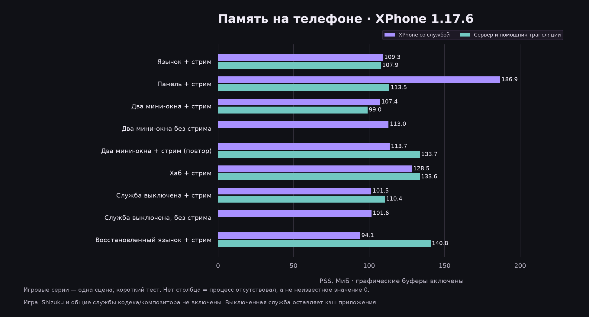
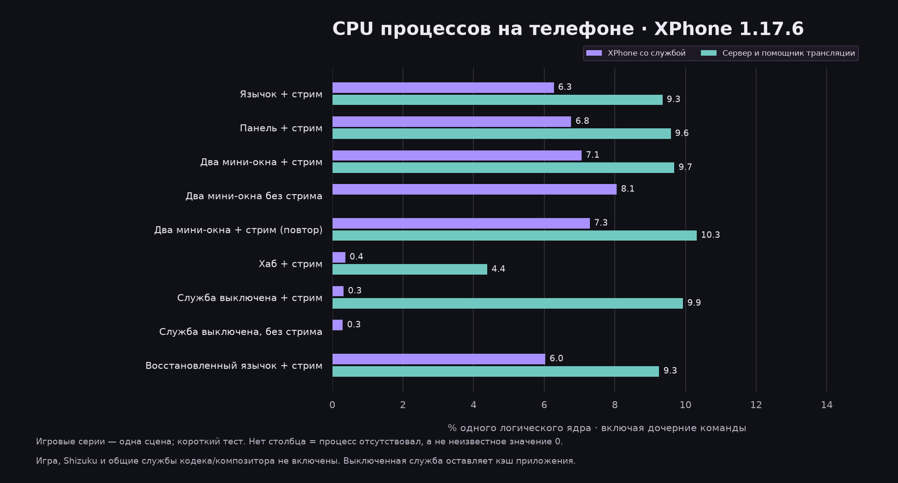
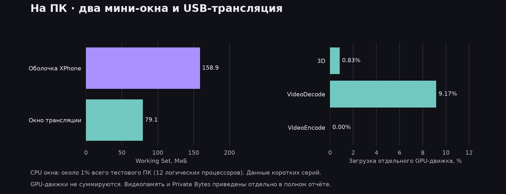

# Ресурсы XPhone 1.17.6: телефон и USB-трансляция

Измерено 6 ноября 2026 на одном подключённом устройстве Samsung. Это анализ ресурсов в фиксированной сцене, **не подтверждение ускорения игры** и не стресс-тест настоящего матча. Идентификаторы устройства и данные аккаунтов не сохранены в публикуемых материалах.

## Условия и методика

- Android-приложение 1.17.6; Android 17 / SDK 37. Открытый Windows-клиент — **1.4.1**, не версия исходников 1.4.2.
- Mobile Legends: одна и та же страница основных настроек с анимированным предпросмотром. После переходов через хаб страница открывалась заново. Матч не запускался; игровая нагрузка здесь ниже и иная, чем в бою.
- Экран 1440×3120, системный режим 120 Гц; хаб фактически оставался в горизонтальном положении. Сцены хаба и игры не равны по нагрузке.
- USB; max-size 2336, ограничение потока 60 FPS, битрейт до 30 Мбит/с; playback-аудио, видеобуфер 0 мс, аудиобуфер 30 мс. В сцене не было активного голосового чата. Значения лимитов не являются измеренной скоростью или FPS потока.
- Перед каждой серией 15 секунд стабилизации, затем 6 интервалов примерно по 11 секунд. Фактическая продолжительность указана в таблице; сбор памяти занимает дополнительное время.
- Память Android — PSS, графические буферы уже включены. Swap PSS указан отдельно в JSON, его нельзя просто складывать с физической RAM. Общий Shizuku и системные службы выделены отдельно.
- CPU процессов: **100% = одно логическое ядро**; включены завершившиеся дочерние команды. Системный CPU — доля всех ядер телефона. Это разные шкалы.
- Windows: Working Set и Private Bytes измерены отдельно. На ПК 12 логических процессоров, поэтому CPU процесса в шкале одного ядра делится на 12 для шкалы всей машины.
- Не завершались посторонние приложения. Сборщик ADB/meminfo сам создаёт некоторую нагрузку, включённую в системные счётчики; она не вычтена и отдельно не калибрована.
- Выключение игровой службы восстанавливает профильные настройки. Поэтому контроль «служба выключена» показывает пользовательский сценарий, а не чистый эксперимент с единственной изменённой переменной.
- После переподключения окно ПК стало крупнее: примерно 935×463 → 1824×873. Стоимость рендеринга Windows нельзя сравнивать как эксперимент с одинаковым размером окна.
- В первой серии передний план подтверждён снимком; старое имя поля Android давало `other`. Последующие серии дополнительно проверены по `topResumedActivity`. Незавершённая серия с другим меню остановлена и не включена.

## Android: XPhone и отдельные процессы трансляции

| Сценарий | Серия, с | XPhone PSS, МиБ | Диапазон | CPU XPhone, % ядра | Стрим PSS, МиБ | CPU стрима, % ядра |
|---|---:|---:|---:|---:|---:|---:|
| Язычок + стрим | 67,92 | 109,28 | 107,26–115,48 | 6,27 | 107,90 | 9,35 |
| Большая панель + стрим | 68,13 | 186,86 | 185,08–193,43 | 6,77 | 113,53 | 9,59 |
| Два мини-окна + стрим | 68,16 | 107,37 | 104,23–115,00 | 7,06 | 99,03 | 9,68 |
| Два мини-окна, без стрима | 67,42 | 112,95 | 110,94–118,05 | 8,05 | — | — |
| Два мини-окна + стрим, повтор | 67,75 | 113,69 | 111,76–119,29 | 7,29 | 133,67 | 10,32 |
| Хаб + стрим | 64,92 | 128,47 | 123,61–144,33 | 0,37 | 133,60 | 4,39 |
| Служба выключена + стрим | 67,86 | 101,53 | 101,53–101,54 | 0,32 | 110,40 | 9,93 |
| Служба выключена, без стрима | 66,82 | 101,63 | 101,62–101,65 | 0,30 | — | — |
| Восстановленный язычок + стрим | 67,64 | 94,10 | 92,27–99,93 | 6,03 | 140,78 | 9,26 |

В строках выключенной службы остаются кэшированные процессы XPhone. Это не потребление удалённого приложения и не доказательство утечки. Прочерк в колонках стрима означает отсутствие этих процессов. Средние PSS рассчитаны по шести срезам, CPU — с весом по длительности интервала.

## Что добавляет трансляция

Сервер scrcpy и его процесс-помощник занимают отдельную память на телефоне. Но их CPU **не описывает весь тракт**: кодирование и композиция выполняются также общими системными службами. Эти службы нельзя целиком приписывать XPhone.

| Сценарий | CPU аппаратного кодека, % ядра | CPU композитора, % ядра | GPU телефона, % | Системный CPU, % всех ядер |
|---|---:|---:|---:|---:|
| Язычок + стрим | 19,49 | 24,37 | 22,67 | 28,21 |
| Большая панель + стрим | 20,15 | 25,67 | 28,25 | 28,33 |
| Два мини-окна + стрим | 20,11 | 26,25 | 22,99 | 29,37 |
| Два мини-окна, без стрима | 0,00 | 16,27 | 13,51 | 34,03 |
| Два мини-окна + стрим, повтор | 18,51 | 26,70 | 22,51 | 30,01 |
| Хаб + стрим | 0,66 | 0,46 | — | 10,11 |
| Служба выключена + стрим | 20,13 | 24,58 | 22,85 | 30,12 |
| Служба выключена, без стрима | 0,00 | 10,31 | 13,57 | 31,25 |
| Восстановленный язычок + стрим | 21,04 | 24,59 | 22,74 | 26,95 |

GPU — среднее доступных точечных окон `gpubusy`, не интегральная загрузка всей минуты. Нулевой знаменатель означает отсутствие значения, не 0% нагрузки. Общий CPU колебался и без стрима; простое вычитание двух строк не даёт достоверной полной цены трансляции.

## Windows

| Сценарий | Клиент: Working Set, МиБ | Окно: Working Set, МиБ | Окно: Private Bytes, МиБ | CPU окна, % ядра | CPU окна, % всего ПК |
|---|---:|---:|---:|---:|---:|
| Язычок + стрим | 172,38 | 84,21 | 106,16 | 12,21 | 1,02 |
| Большая панель + стрим | 181,90 | 83,17 | 105,79 | 13,81 | 1,15 |
| Два мини-окна + стрим | 158,90 | 79,07 | 103,26 | 12,28 | 1,02 |
| Два мини-окна, без стрима | 151,75 | — | — | — | — |
| Два мини-окна + стрим, повтор | 154,85 | 87,61 | 101,31 | 12,52 | 1,04 |
| Хаб + стрим | 166,27 | 83,25 | 96,55 | 3,32 | 0,28 |
| Служба выключена + стрим | 187,20 | 89,39 | 101,84 | 9,48 | 0,79 |
| Служба выключена, без стрима | 154,77 | — | — | — | — |
| Восстановленный язычок + стрим | 170,18 | 87,88 | 101,41 | 12,71 | 1,06 |

Дополнительные шесть срезов GPU процесса окна, два мини-окна и стрим включены:

| Движок | Среднее, % | Диапазон, % |
|---|---:|---:|
| 3D | 0,83 | 0,00–1,00 |
| VideoDecode | 9,17 | 7,00–10,00 |
| VideoEncode | 0,00 | 0,00–0,00 |

Выделенная видеопамять окна: около 93,43 МиБ; разделяемая GPU-память 11,54–15,23 МиБ. Эти величины не складываются с Working Set как независимая физическая память. Проценты разных GPU-движков также не суммируются в «общий GPU».

## Кадры, температура и размеры

| Сценарий | Композиция экрана, кадр/с | Батарея, °C | Тепловой статус Android |
|---|---:|---:|---|
| Язычок + стрим | 89,62 | 35,90–36,00 | 0 |
| Большая панель + стрим | 89,95 | 36,00–36,10 | 0 |
| Два мини-окна + стрим | 90,17 | 36,20–36,20 | 0 |
| Два мини-окна, без стрима | 89,59 | 36,10–36,20 | 0 |
| Два мини-окна + стрим, повтор | 89,92 | 36,10–36,10 | 0 |
| Хаб + стрим | 0,22 | 36,00–36,10 | 0 |
| Служба выключена + стрим | 119,42 | 36,00–36,20 | 0 |
| Служба выключена, без стрима | 89,78 | 36,30–36,50 | 0 |
| Восстановленный язычок + стрим | 90,05 | 36,60–36,70 | 0 |

Системный датчик AP: 39,60–43,30 °C. Это значения, возвращённые thermalservice (могут быть кэшированы), не независимо измеренная температура кристалла.

Системный датчик SKIN: 36,40–38,00 °C. Это значения, возвращённые thermalservice (могут быть кэшированы), не независимо измеренная температура кристалла.

Глобальный `SurfaceFlinger totalFrames` не является счётчиком уникальных кадров игры или доставленных кадров scrcpy. В одной серии с выключенной службой и включённым стримом он показал около 119 кадров/с, тогда как другие игровые серии — около 90. Нельзя превращать это в вывод «оверлей отнимает 30 FPS»: нужно отдельно исследовать кадры игрового слоя, виртуальный захват, режимы композиции и влияние переходов приложения. Показатель не используется здесь как доказательство падения или прироста игрового FPS.

Телефон весь прогон питался по USB. Тепловой статус оставался 0; это отсутствие сообщения о троттлинге в данных, а не доказательство отсутствия любых ограничений частот. Батарея и AP/корпус — разные датчики. Расход батареи в час, автономность и прибавка температуры именно от XPhone этим прогоном не определены.

APK в локальной папке сборки: 1 004 326 байт (около 0,96 МиБ), без данных/кэша установленного приложения. Папка поставки Windows: 173 705 005 байт (около 165,66 МиБ), включая движок и среду выполнения. Это размеры конкретных локальных файлов, не размер каждого скачивания или установки.

## Выводы и приоритеты

1. Хаб на статичном экране требует заметно меньше CPU, чем активная игровая телеметрия. Закрытие большой панели экономит графическую память, но не выключает сбор показателей.
2. При одном язычке большая часть измеренного CPU XPhone относится к вспомогательным командам. В `Overlay.showHandle` сохраняется подписка `warmMetrics`; `TelemetryFeed` опрашивает все поля каждые две секунды. Это подтверждённая точка для оптимизации; стоимость каждой команды отдельно ещё не профилировалась.
3. Первое изменение для слабых устройств: управлять набором и частотой измерений по видимым окнам, сохранив быстрый показ кэшированных значений. Затем отдельно проверить аллокации панелей и буферы. В ходе замеров код и частоты опроса не менялись.
4. Стрим имеет собственную цену и на телефоне, и на ПК; аппаратные кодек/декодер не означают нулевую нагрузку. Рекомендовать настройки слабому телефону следует после реального теста на нём.
5. Изменения PSS после прогрева, закрытия панели и переподключения не доказывают утечку. Нужен отдельный длительный повторяемый тест. Глобальный счётчик кадров требует отдельной проверки до заявлений о влиянии оверлея на игру.

## Что не измерено и не включено в результаты

Реальный матч/тяжёлая сцена и 1% low игры; доставленные FPS и потери кадров потока; сквозная задержка изображения/касания/звука; Wi-Fi/LAN и сетевой битрейт; запись экрана одновременно со стримом; активные касания и другие приложения в окнах; Full Focus и все профили питания; автономность; часовой тест утечек и тепловой стресс; слабые устройства и другие модели. Их нельзя заменять нулями или считать проверенными по этому отчёту.

## Данные и повторение

[Сводный CSV](summary.csv) · [Полная сводка JSON](summary.json) · [Условия](conditions.json) · [GPU ПК](pc-gpu.json). В `series/` сохранены обезличенные интервалы без PID, абсолютных часов, идентификаторов и содержимого экрана. Исходные локальные захваты остаются в игнорируемой папке `dist/bench-1.17.6`.

Сборщик: `docs/tools/benchmark_resources.py` (Python + psutil), агрегация: `summarize_benchmark.py`, диаграммы: `plot_benchmark.py`, отчёт: `write_benchmark_report.py`. Перед серией вручную установите и визуально подтвердите нужный экран. При смене сцены/процесса серия требует повторения. В итоговом состоянии трансляция и игровая служба включены; тестовые мини-окна выключены.
